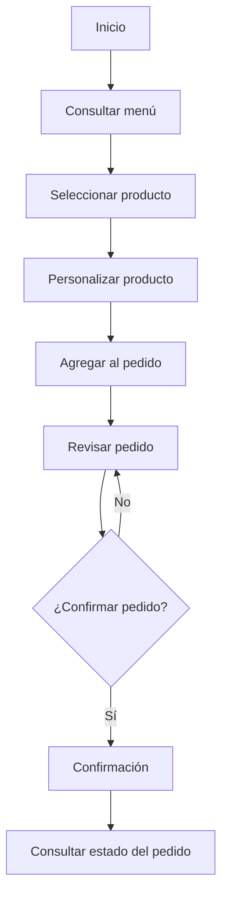

# ☕ CaféU 2.0 – Sistema de pedidos para cafetería universitaria


## 📖 Descripción

CaféU 2.0 es una aplicación web orientada a facilitar el proceso de pedidos en cafeterías universitarias, permitiendo a los usuarios consultar el menú, seleccionar productos, personalizar sus pedidos y visualizar el estado de su solicitud desde una interfaz intuitiva y accesible.

El sistema surge como una evolución del prototipo CaféU, desarrollado en la asignatura de Interacción Humano-Computador (IHC), incorporando mejoras identificadas durante las evaluaciones de usabilidad y el análisis heurístico realizados en el APE6.

## 🎯 Objetivo

Desarrollar una aplicación web que facilite la gestión de pedidos en una cafetería universitaria, aplicando principios de usabilidad, accesibilidad y diseño centrado en el usuario, con una arquitectura que favorezca el mantenimiento y la escalabilidad del software.

## ✨ Características principales

- Visualización del catálogo de productos.
- Búsqueda y filtrado por categorías.
- Consulta del detalle y precio de cada producto.
- Personalización de pedidos mediante instrucciones especiales.
- Gestión del carrito de compras.
- Modificación de cantidades y eliminación de productos.
- Opción para deshacer la eliminación de un producto.
- Cálculo automático de subtotales y total del pedido.
- Confirmación y visualización del estado del pedido.
- Generación de comprobantes de demostración.
- Almacenamiento local de la información.

## 🛠️ Tecnologías utilizadas

| Tecnología | Descripción |
|------------|-------------|
| JavaScript | Desarrollo de la lógica y funcionalidades del sistema. |
| Vite | Entorno de desarrollo y compilación de la aplicación. |
| Node.js | Entorno de ejecución para las herramientas de desarrollo. |
| npm | Gestión de dependencias del proyecto. |
| LocalStorage | Persistencia local de los pedidos. |
| Git y GitHub | Control de versiones y trabajo colaborativo. |
| Figma | Diseño y prototipado de interfaces. |

## 📋 Requisitos previos

Antes de ejecutar el proyecto, es necesario contar con:

- Node.js 20 o superior.
- npm.
- Navegador web actualizado.
- Git (opcional).

## 🚀 Instalación y ejecución

### 1. Obtener el proyecto

Clonar el repositorio desde GitHub o descargar el código fuente e ingresar a la carpeta del proyecto.

### 2. Instalar las dependencias

```bash
npm install
```

### 3. Iniciar el servidor de desarrollo

```bash
npm run dev
```

### 4. Acceder a la aplicación

Abrir el navegador e ingresar a la dirección proporcionada por Vite:

[http://localhost:5173](http://localhost:5173)

## 📱 Módulos del sistema

| Módulo | Descripción |
|--------|-------------|
| Inicio | Presenta la pantalla principal y el acceso al menú. |
| Menú | Permite consultar, buscar y filtrar los productos disponibles. |
| Detalle del producto | Muestra la información del producto y permite personalizarlo. |
| Mi pedido | Permite revisar, modificar y eliminar los productos seleccionados. |
| Estado del pedido | Presenta información sobre el estado de la solicitud. |
| Confirmación | Muestra la confirmación y el comprobante del pedido. |

## 🏗️ Arquitectura del sistema

El proyecto utiliza una arquitectura por capas que permite separar la interfaz de usuario, la lógica de negocio y los mecanismos de almacenamiento.

- **Presentación:** interfaces y componentes con los que interactúa el usuario.
- **Aplicación:** casos de uso y coordinación de las operaciones del sistema.
- **Dominio:** entidades, reglas y lógica de negocio.
- **Infraestructura:** implementación del catálogo y mecanismos de persistencia.

### Estructura del proyecto

```text
CaféU/
├── src/
│   ├── application/
│   │   ├── ports/
│   │   └── use-cases/
│   ├── domain/
│   │   ├── entities/
│   │   ├── errors/
│   │   └── services/
│   ├── infrastructure/
│   │   ├── catalogo/
│   │   └── persistence/
│   └── presentation/
├── tests/
├── docs/
├── evaluacion/
└── README.md
```

Para más información, consultar la [documentación de arquitectura](docs/arquitectura.md).

## 🔄 Flujo de funcionamiento



## 🧪 Pruebas del sistema

Para ejecutar las pruebas técnicas del proyecto:

```bash
npm test
```

Para generar la versión de producción:

```bash
npm run build
```

Para visualizar la versión compilada:

```bash
npm run preview
```

## 🎨 Diseño y experiencia de usuario

El desarrollo de CaféU 2.0 toma como referencia el prototipo elaborado en Figma y los resultados de las evaluaciones realizadas durante el APE6.

Las mejoras implementadas están orientadas a:

- Facilitar la navegación entre las pantallas.
- Mejorar la claridad de la información.
- Prevenir errores durante la realización de pedidos.
- Proporcionar retroalimentación sobre las acciones del usuario.
- Facilitar la modificación de productos seleccionados.
- Mantener una interfaz consistente durante el proceso de compra.

## 💾 Almacenamiento de datos

La aplicación utiliza `localStorage` para conservar la información del pedido en el navegador, permitiendo mantener los datos al actualizar la página.

Para restablecer los datos de demostración, ejecutar en la consola del navegador:

```javascript
localStorage.removeItem("cafeu.pedido.v2");
location.reload();
```

## 📚 Documentación

| Documento | Contenido |
|-----------|-----------|
| [Arquitectura](docs/arquitectura.md) | Organización y estructura del sistema. |
| [Validación V2](evaluacion/validacion-v2.md) | Mejoras implementadas y seguimiento de hallazgos. |
| [Colaboración Git](docs/colaboracion-git.md) | Lineamientos para el trabajo colaborativo. |

## 🤝 Trabajo colaborativo

El desarrollo del proyecto se realiza mediante Git y GitHub, utilizando ramas individuales, commits descriptivos y Pull Requests para integrar las funcionalidades desarrolladas por cada integrante.

## 📌 Alcance del proyecto

CaféU 2.0 corresponde a una implementación académica funcional del lado del cliente. Actualmente utiliza datos de demostración y almacenamiento local, sin conexión a un servidor, base de datos centralizada o sistema real de pagos.

Las pruebas técnicas realizadas no sustituyen una nueva evaluación de usabilidad con usuarios.

## 🎓 Información académica

- **Universidad:** Universidad Técnica de Ambato.
- **Facultad:** Facultad de Ingeniería en Sistemas, Electrónica e Industrial.
- **Carrera:** Ingeniería de Software.
- **Asignatura:** Interacción Humano-Computador.
- **Proyecto:** CaféU 2.0.

## 📄 Licencia y uso

Proyecto desarrollado con fines académicos y educativos.

---

**CaféU 2.0 — Una experiencia más sencilla e intuitiva para realizar pedidos universitarios.**
