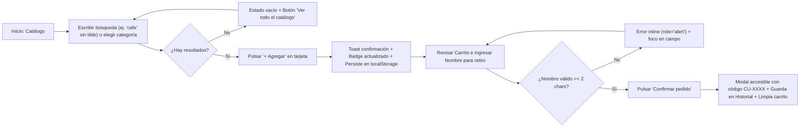
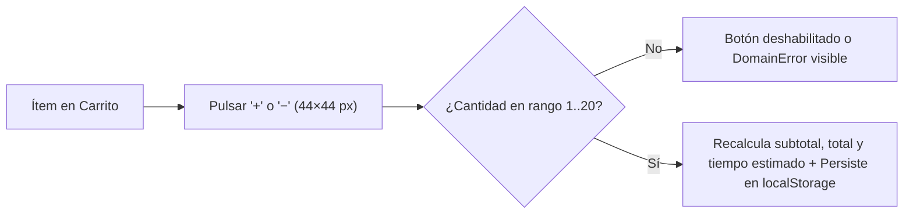
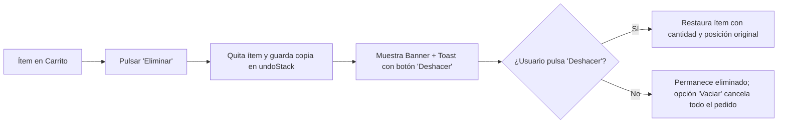

# User Flows — CaféU 2.0 (Compra, Modificación y Cancelación/Recuperación)

## 1. Flujo de Compra Completa (T1 + T3)

## 2. Flujo de Modificación de Cantidades (T2)

## 3. Flujo de Eliminación, Recuperación (Deshacer) y Cancelación (T3)

