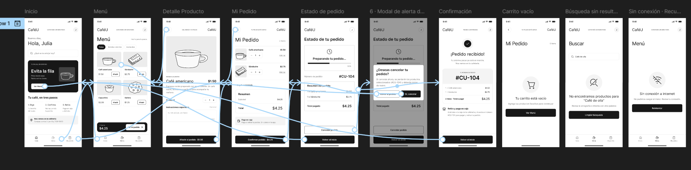

# Estados de interfaz, errores y recuperación - CaféU 2.0

## 1. Objetivo

Documentar los estados principales y alternativos representados en los prototipos de CaféU 2.0. El propósito es especificar qué debe ver el usuario, qué puede hacer y cómo puede continuar cuando una operación no produce el resultado esperado.

Este documento describe el comportamiento esperado del diseño. La presencia de una pantalla en el prototipo no demuestra por sí sola que el comportamiento ya esté implementado; cada caso debe verificarse en la aplicación.

## 2. Estados del flujo principal

### 2.1 Inicio

* **Situación:** el usuario ingresa a CaféU 2.0.
* **Información visible:**
  * Identidad de CaféU.
  * Mensaje de bienvenida.
  * Acceso al buscador.
  * Acceso destacado al menú.
  * Navegación principal.
* **Acciones esperadas:**
  * Abrir el menú.
  * Buscar un producto.
  * Acceder a las secciones disponibles desde la navegación.
* **Resultado esperado:** el usuario puede identificar rápidamente cómo comenzar un pedido.

### 2.2 Menú o catálogo

* **Situación:** el usuario consulta los productos disponibles.
* **Información visible:**
  * Nombre y representación visual del producto.
  * Precio.
  * Categorías o filtros disponibles.
  * Acción para abrir el detalle o agregar el producto, según el diseño implementado.
* **Acciones esperadas:**
  * Explorar productos.
  * Filtrar por categoría.
  * Abrir el detalle de un producto.
  * Agregar un producto al pedido si la interfaz ofrece esa acción.
* **Resultado esperado:** el usuario puede encontrar y seleccionar un producto sin confundir su nombre o precio.

### 2.3 Detalle del producto

* **Situación:** el usuario selecciona un producto del catálogo.
* **Información visible:**
  * Imagen o representación del producto.
  * Nombre.
  * Precio.
  * Descripción o información disponible.
  * Selector de cantidad.
  * Campo de indicaciones especiales, si corresponde.
* **Acciones esperadas:**
  * Modificar la cantidad.
  * Escribir indicaciones cuando la opción esté disponible.
  * Agregar el producto al pedido.
  * Regresar al catálogo.
* **Resultado esperado:** el producto se incorpora al pedido con la cantidad seleccionada y el usuario recibe una confirmación visual.

### 2.4 Mi pedido o carrito con productos

* **Situación:** el usuario revisa los productos seleccionados.
* **Información visible:**
  * Productos agregados.
  * Cantidad por producto.
  * Subtotal y total.
  * Acciones para modificar o eliminar productos.
  * Acción para confirmar el pedido.
* **Acciones esperadas:**
  * Aumentar o disminuir cantidades.
  * Eliminar un producto.
  * Revisar el total actualizado.
  * Continuar con la confirmación.
* **Resultado esperado:** las cantidades y los importes se actualizan de manera coherente con los cambios realizados.

### 2.5 Estado del pedido

* **Situación:** el usuario consulta el estado de un pedido enviado.
* **Información visible:**
  * Identificador del pedido.
  * Estado actual.
  * Resumen de productos e importes disponible en la interfaz.
* **Acciones esperadas:**
  * Consultar el estado.
  * Regresar al inicio cuando la interfaz lo permita.
  * Solicitar la cancelación si esa opción está habilitada.
* **Resultado esperado:** el usuario comprende en qué estado se encuentra el pedido. No se debe presentar un estado como actualizado en tiempo real si la aplicación no dispone de esa funcionalidad.

### 2.6 Modal de confirmación de cancelación

* **Situación:** el usuario intenta cancelar un pedido.
* **Información visible:**
  * Pregunta clara sobre si desea cancelar.
  * Consecuencia de la acción, cuando aplique.
  * Acción para confirmar la cancelación.
  * Acción para conservar el pedido.
* **Acciones esperadas:**
  * Confirmar la cancelación.
  * Cancelar el diálogo y mantener el pedido.
* **Resultado esperado:** la cancelación no se ejecuta accidentalmente. Si el usuario elige conservar el pedido, el modal se cierra sin modificarlo.

### 2.7 Confirmación del pedido

* **Situación:** el usuario completa el proceso de pedido.
* **Información visible:**
  * Mensaje de confirmación.
  * Identificador del pedido.
  * Resumen de productos y total, si está disponible.
  * Acción para volver al inicio.
* **Resultado esperado:** el usuario recibe una señal inequívoca de que la operación fue aceptada por la aplicación. El mensaje debe corresponder al resultado real de la operación.

## 3. Estados alternativos y errores

### 3.1 Carrito vacío

* **Situación:** el usuario abre «Mi pedido» sin haber agregado productos o después de eliminar todos los productos.
* **Mensaje esperado:** indicar que el carrito está vacío y orientar al usuario para comenzar.
* **Acción de recuperación:** botón o enlace para volver al menú.
* **Criterio de aceptación:**
  * El estado vacío se distingue de un error.
  * No se muestran totales de una compra inexistente.
  * La acción para volver al menú es visible y funcional.

### 3.2 Búsqueda sin resultados

* **Situación:** el usuario escribe una consulta que no coincide con los productos disponibles.
* **Mensaje esperado:** indicar que no se encontraron productos para la búsqueda realizada.
* **Acciones de recuperación:**
  * Modificar el texto de búsqueda.
  * Limpiar la búsqueda, si la interfaz ofrece esa opción.
  * Revisar la escritura o intentar con otro término.
* **Criterio de aceptación:**
  * El mensaje no debe confundirse con un fallo de conexión.
  * La consulta debe poder modificarse sin reiniciar la aplicación.
  * La búsqueda debe tratar de forma consistente mayúsculas y minúsculas y, según el requisito del proyecto, caracteres con y sin tilde.

### 3.3 Sin conexión

* **Situación:** la aplicación no puede completar una operación porque no existe conectividad.
* **Mensaje esperado:** informar que no hay conexión y explicar que la operación no pudo completarse.
* **Acción de recuperación:** ofrecer reintentar cuando la conectividad pueda haberse restablecido.
* **Criterio de aceptación:**
  * El usuario recibe información comprensible.
  * No se informa que un pedido fue confirmado si la operación no se completó.
  * La acción de reintento está disponible cuando corresponda.
  * La aplicación no debe perder silenciosamente los datos que el usuario todavía no ha enviado, siempre que la arquitectura lo permita.

> **Nota:** La pantalla prototipada representa el estado sin conexión. La detección real de conectividad y el reintento deben verificarse en la implementación.

### 3.4 Error al confirmar el pedido

* **Situación:** el usuario intenta confirmar el pedido, pero la operación falla.
* **Comportamiento esperado:**
  * Informar que el pedido no pudo confirmarse.
  * Mantener visible la información del pedido para que el usuario pueda revisarla.
  * Permitir volver a intentar o regresar a la pantalla anterior.
* **Criterio de aceptación:**
  * No mostrar la pantalla de confirmación exitosa ante un fallo.
  * Evitar duplicar pedidos si el usuario reintenta.
  * Comunicar el resultado de forma clara.

> **Nota:** Este caso debe comprobarse en la aplicación; si todavía no existe una pantalla específica, debe registrarse como mejora pendiente en lugar de afirmar que está resuelto.

### 3.5 Error al cargar el catálogo

* **Situación:** los productos no pueden mostrarse.
* **Comportamiento esperado:**
  * Diferenciar el error de carga de un catálogo que realmente no contiene productos.
  * Mostrar un mensaje informativo.
  * Ofrecer reintentar cuando sea posible.
* **Criterio de aceptación:**
  * No presentar el estado «sin resultados» como sustituto de un error de carga.
  * No dejar la pantalla indefinidamente vacía sin explicación.

## 4. Reglas generales de interacción

1. Las acciones principales deben tener etiquetas comprensibles.
2. Las acciones destructivas deben solicitar confirmación cuando corresponda.
3. Los errores deben explicar qué ocurrió sin utilizar mensajes técnicos innecesarios.
4. Los estados vacíos deben indicar cómo continuar.
5. Los cambios en cantidades y totales deben reflejarse de manera consistente.
6. Los controles deben poder identificarse y utilizarse con teclado.
7. El foco del teclado debe ser visible.
8. Los mensajes dinámicos importantes deben poder ser percibidos por tecnologías de asistencia.
9. Los diálogos deben permitir una salida clara y no dejar al usuario interactuando accidentalmente con el contenido de fondo.

## 5. Matriz resumida de estados

| Pantalla o estado | Causa | Respuesta de la interfaz | Recuperación |
| :--- | :--- | :--- | :--- |
| **Inicio** | Entrada a la aplicación | Mostrar bienvenida y accesos | Abrir menú o búsqueda |
| **Menú** | Consulta del catálogo | Mostrar productos y categorías | Cambiar categoría o seleccionar producto |
| **Detalle producto** | Selección de producto | Mostrar información y cantidad | Regresar o agregar |
| **Mi pedido** | Hay productos agregados | Mostrar cantidades y total | Editar o eliminar |
| **Estado del pedido** | Pedido enviado | Mostrar identificador y estado | Volver o solicitar cancelación si está habilitada |
| **Modal de cancelación** | Solicitud de cancelar | Pedir confirmación | Confirmar o conservar pedido |
| **Confirmación** | Pedido aceptado | Mostrar resultado e identificador | Volver al inicio |
| **Carrito vacío** | No hay productos | Explicar que no hay artículos | Volver al menú |
| **Búsqueda sin resultados** | Consulta sin coincidencias | Informar que no hay resultados | Modificar o limpiar búsqueda |
| **Sin conexión** | Falta de conectividad | Informar que no hay conexión | Reintentar |
| **Error de confirmación** | Fallo al enviar pedido | Informar que no se confirmó | Reintentar o revisar pedido |

## 6. Verificación pendiente en la aplicación

Marcar cada punto únicamente después de probarlo en la versión ejecutable:

- [ ] El carrito vacío aparece cuando no existen productos.
- [ ] La búsqueda sin resultados permite modificar la consulta.
- [ ] La búsqueda contempla mayúsculas/minúsculas.
- [ ] La búsqueda contempla tildes de acuerdo con el comportamiento requerido.
- [ ] El aviso de falta de conexión se muestra en la condición correspondiente.
- [ ] Reintentar ejecuta una acción real y comunica su resultado.
- [ ] La cancelación solicita confirmación.
- [ ] Elegir conservar el pedido no lo modifica.
- [ ] La confirmación solo aparece cuando el pedido fue aceptado.
- [ ] Los errores no provocan pérdida silenciosa de la información ingresada.

